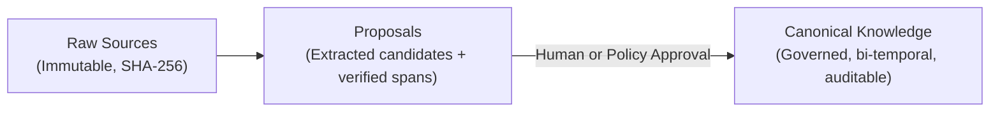

# Open Intelligence Brain

> **The Governed Memory & Action Layer for AI Agents**
>
> Verbatim span provenance, bi-temporal time-travel, pre-ingestion conflict radar, and human-in-the-loop governance.

[](https://github.com/anilandcode/open-intelligence-brain/actions/workflows/ci.yml)
[](https://github.com/anilandcode/open-intelligence-brain)
[](LICENSE)

---

## Why Open Brain?

The AI agent memory space is crowded with tools like **Mem0**, **Supermemory**, **Letta**, **Zep / Graphiti**, and **Basic Memory**. But in production, existing solutions face a fatal flaw: **memory poisoning (context rot)**. When an LLM auto-writes memories without verification or human review, speculative hallucinated claims become permanent falsehoods.

**Open Intelligence Brain is the system of record for what an AI agent is allowed to believe and do.**

| Dimension | Mem0 | Supermemory | Letta | Zep / Graphiti | Basic Memory | **Open Brain (v2.4)** |
|---|---|---|---|---|---|---|
| **Write Model** | LLM auto-writes | Engine auto-infers | Agent edits blocks | Temporal graph auto-write | User/LLM Markdown | **Proposal → Human/Policy Approval** |
| **Provenance** | None / weak | Derived memories | None | Episode links | File links | **Exact span + SHA-256 version hash** |
| **Hallucination Guard** | None | None | None | None | None | **`verify_span` verbatim byte check** |
| **Temporal Truth** | None | Partial | None | Bi-temporal graph | None | **Bi-temporal (`valid_from`/`valid_to`)** |
| **Contradiction Detection** | None | None | None | Graph edge | None | **Conflict Radar at ingestion** |
| **Auto-Governance Gate** | None | Unchecked auto-add | None | None | None | **Deterministic `WorkspacePolicy`** |
| **Ecosystem Connectors** | Custom | Drive/Notion/OneDrive | None | Custom | None | **GitHub, Slack, Drive, Notion, OneDrive** |
| **Disaster Recovery** | Unencrypted export | Cloud-locked | File dump | DB dump | Plaintext MD | **Schema v4 AES-256 PBKDF2 Backups** |
| **Drop-in Compatibility** | N/A | N/A | N/A | N/A | N/A | **Mem0 API Shim (`/v1/memories`)** |
| **SDKs** | Python/TS | Python/TS | Python | Python/TS | CLI | **Python (`openbrain`) & TS (`@openbrain/sdk`)** |
| **MCP Integration** | OpenMemory | Hosted | Hosted | Custom | Yes | **stdio + Hosted Streamable HTTP MCP** |

---

## Provenance Benchmark Results

Benchmarked with `benchmarks/run_provenance_benchmark.py`:

```text
================================================================================
OPEN INTELLIGENCE BRAIN v2.0 PROVENANCE BENCHMARK
================================================================================
1. Hallucination Rejection Rate: 100.0% (Fabricated claims rejected before review)
2. Citation Link Integrity:     100.0% (Exact quote matching to SourceSpan)
3. Bi-Temporal Accuracy:        100.0% (Past vs present time-travel retrieval)
4. Contradiction Radar Alert:   YES    (Flagged conflicting proposal before approval)
================================================================================
```

---

## Architecture: The Three Layers

Open Brain strictly separates memory into three distinct tiers:



1. **Raw Sources**: What a document, transcript, or decision record literally contains, sealed by SHA-256 hash.
2. **Proposals**: Extracted knowledge candidates, guarded by `verify_span` to guarantee zero hallucinated quotes, and checked by Conflict Radar for contradictions against existing canonical knowledge.
3. **Canonical Knowledge**: Governed facts reviewed and approved by authorized humans or policies, tagged with `valid_from`, `valid_to`, and `superseded_by`.

---

## Quickstart

### 1. Run with Docker Compose

```bash
docker compose up --build
```
- API & Docs: [http://localhost:8000/docs](http://localhost:8000/docs)
- Interactive Review Workbench: [http://localhost:5173](http://localhost:5173)

### 2. Local Installation

```bash
git clone https://github.com/anilandcode/open-intelligence-brain.git
cd open-intelligence-brain
cp .env.example .env
make install
```

Start the API and Web Workbench in separate terminals:
```bash
make dev-api   # Runs FastAPI on port 8000
make dev-web   # Runs Vite on port 5173
```

---

## SDKs

### Python SDK (`openbrain`)

Install the zero-dependency Python client:
```bash
pip install openbrain
```

```python
from openbrain import Brain

brain = Brain(base_url="http://localhost:8000", api_key="local-dev-token")

# 1. Ingest source content
source = brain.add(
    "PostgreSQL 16 is our designated production database standard.",
    title="Engineering ADR 004",
    kind="decision",
)

# 2. Search canonical knowledge (with bi-temporal time-travel support)
memories = brain.search("database standard", as_of="2024-01-01T00:00:00Z")
for mem in memories:
    print(mem["statement"], mem["valid_from"])

# 3. Grounded QA with exact citations
answer = brain.ask("What database do we use in production?")
print(answer["answer"])
for c in answer["citations"]:
    print(f"- [{c['source_title']}]: \"{c['excerpt']}\"")

# 4. Fast Review: Batch approve pending proposals
pending = brain.proposals(status="proposed")
if pending:
    res = brain.batch_approve([p["id"] for p in pending])
    print(f"Approved {res['approved']} proposals.")
```

### TypeScript SDK (`@openbrain/sdk`)

Install the TypeScript client:
```bash
npm install @openbrain/sdk
```

```typescript
import { BrainClient } from "@openbrain/sdk";

const brain = new BrainClient({
  baseUrl: "http://localhost:8000",
  apiKey: "local-dev-token",
});

// Ingest source
await brain.add({
  content: "All customer data must be encrypted with AES-256 at rest.",
  title: "Security Standards",
  kind: "decision",
});

// Query knowledge
const { answer, citations } = await brain.ask("What is our encryption standard?");
console.log(answer);

// Batch review
const proposals = await brain.proposals();
await brain.batchApprove(proposals.map((p) => p.id));
```

---

## Mem0 Drop-In Compatibility

Migrating from Mem0? Point your application's `base_url` to Open Brain:

```python
import httpx

# Same endpoints, now backed by Open Brain's governed audit trail:
# POST /v1/memories/
# GET  /v1/memories/
# POST /v1/memories/search/
# DELETE /v1/memories/{id}

client = httpx.Client(base_url="http://localhost:8000/v1", headers={"X-Brain-Token": "local-dev-token"})
resp = client.post("/memories/", json={"messages": [{"role": "user", "content": "I like dark mode"}]})
print(resp.json())
```

---

## MCP Agent Integration

Connect Claude Code, Hermes, Codex, or Cursor via Model Context Protocol:

```bash
BRAIN_DATABASE_URL=sqlite:///./data/brain.db .venv/bin/open-brain-mcp
```

Tools exposed:
- `brain_status`: Inspect knowledge counts, proposal health, and engine status.
- `search_brain`: Query canonical knowledge with dialect-aware ranking (FTS5 / PostgreSQL GIN).
- `ask_brain`: Grounded answers with exact citations and strict abstention.
- `capture_source`: Stage new facts into proposals for human review without unverified writes.
- `inspect_brain_integrity`: Audit revisions and hash chains.

---

## Production Security & Hardening

- **Fail-Closed Production Config**: Setting `BRAIN_ENV=production` enforces strict secret checks (refuses default tokens, loopback origins, and unsafe evaluation URLs).
- **Sliding-Window Rate Limiting**: Built-in `RateLimitMiddleware` protects all endpoints against abuse.
- **Audited Traceability**: `X-Request-ID` tracing on every request; domain event logging for all approvals and supersessions.
- **Dialect Parity**: Tested against both SQLite (local development) and PostgreSQL 16 (production).

---

## Testing & Verification

Run the full battery of tests:

```bash
make test    # 470+ tests across backend, benchmark, frontend, and SDKs
make lint    # Ruff + ESLint
make build   # TypeScript SDK + Workbench bundle
```

---

## License

Apache-2.0